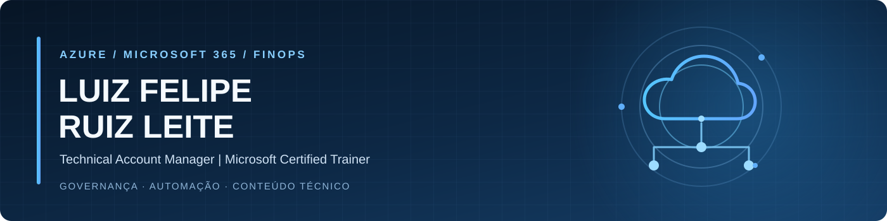

# Fala, pessoALL!

**Azure | Microsoft 365 | FinOps | Governança | Automação | TAM | MCT**

---

### Atividade no GitHub

  
  

### Pac-Man das contribuições

<picture>
  <source media="(prefers-color-scheme: dark)" srcset="https://raw.githubusercontent.com/lfrleite/lfrleite/output/pacman-contribution-graph-dark.svg">
  <source media="(prefers-color-scheme: light)" srcset="https://raw.githubusercontent.com/lfrleite/lfrleite/output/pacman-contribution-graph.svg">
  
</picture>

### Sobre mim

Sou **Luiz Felipe Ruiz Leite**, **Technical Account Manager (TAM)** na **Solo Network** e **Microsoft Certified Trainer (MCT)**. Trabalho com tecnologias Microsoft, especialmente **Azure e Microsoft 365**, conectando as necessidades de negócio às decisões técnicas do dia a dia.

Minha rotina envolve entender ambientes, investigar problemas, recomendar melhorias, apoiar operações e transformar o que aprendo em documentação que outras pessoas possam utilizar.

- **Azure e infraestrutura:** administração de ambientes IaaS, inventário de recursos, disponibilidade, atualização de sistemas, backup e recuperação.
- **FinOps e otimização:** análise de consumo, Azure Hybrid Benefit, reservas, identificação de recursos ociosos e oportunidades de redução de desperdício.
- **Governança e segurança:** organização de subscriptions, TAGs, Azure Policy, RBAC, Microsoft Defender for Cloud e boas práticas de configuração.
- **Automação e operações:** PowerShell, Azure CLI, Azure Resource Graph, KQL, Azure Automation, Azure Update Manager e fluxos de automação no GitHub.
- **Treinamento e comunidade:** produção de artigos, laboratórios e materiais de capacitação sobre tecnologias Microsoft.
- **Em desenvolvimento:** aprofundamento em infraestrutura como código, práticas de DevOps e aplicações de inteligência artificial em operações de TI.

### Experiência

**Technical Account Manager | Solo Network Brasil S/A**

- Consultoria técnica e acompanhamento de ambientes Microsoft Azure, com foco em operação, governança e evolução tecnológica.
- Apoio a análises de custos e recomendações FinOps, considerando consumo, reservas, licenciamento e otimização de recursos.
- Diagnóstico de ambientes, avaliação de riscos técnicos e recomendações relacionadas a disponibilidade, segurança, backup e atualização.
- Desenvolvimento e documentação de scripts, consultas e procedimentos para inventário, validação e automação de tarefas operacionais.
- Interface técnica entre as necessidades do cliente e as equipes responsáveis pela operação e implementação.

**Microsoft Certified Trainer (MCT) | Ensino e conteúdo técnico**

- Preparação de aulas, laboratórios e materiais de treinamento baseados na documentação oficial Microsoft.
- Produção de conteúdos que conectam conceitos de arquitetura a cenários práticos de administração e troubleshooting.

### Projetos e conteúdo técnico

- **[Ruiz Online](https://github.com/lfrleite/Ruiz-Online)** — biblioteca de scripts, consultas e guias de Azure, Microsoft Entra, Intune, Microsoft 365 e Microsoft Defender.
- **[Azure Resource Graph Queries](https://github.com/lfrleite/Ruiz-Online/tree/main/Azure%20Resource%20Graph%20Queries)** — consultas KQL para inventário, governança, segurança, monitoramento e operações no Azure.
- **[Azure FinOps APIs](https://github.com/lfrleite/Ruiz-Online/tree/main/Azure%20FinOps%20APIs)** — materiais de coleta de custos, consumo e reservas por APIs apropriadas.
- **[Azure Image Builder e GitHub Actions](https://github.com/lfrleite/Ruiz-Online/tree/main/Azure%20Image%20Builder%20-%20GitHub%20Actions)** — exemplos de automação de imagens com Bicep e integração ao GitHub Actions.
- **[Blog Ruiz Solutions](https://blog.ruizsolutions.online/)** — artigos técnicos e tutoriais sobre Microsoft Azure, automação e administração de ambientes.

### Tecnologias

**Cloud e ecossistema Microsoft** 

**Automação, scripts e infraestrutura** 

**FinOps e governança** 

